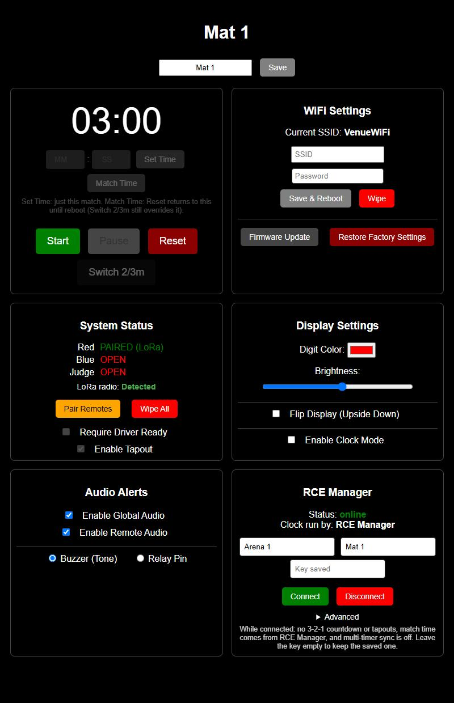

# RCE Manager integration (experimental)

> **Status: pre-release, on branch `rce_integration`.** It has been tested end to end against a mock of the documented protocol on real hardware, but **not yet against the real RCE Manager service**. It is not part of any release. See [What is and isn't verified](#what-is-and-isnt-verified).

This lets an ArenaTimer act as a hardware timer for an arena in [RCE Manager](https://www.rcemanager.com), using the device protocol in [BotCodeBashers/rce-manager-integrations](https://github.com/BotCodeBashers/rce-manager-integrations) (live connection + timer control, v1):

* RCE Manager can **start, pause, reset and set the time** on the timer (the Arena Manager's tablet buttons drive the display).
* The timer's own controls (web page buttons and the Judge remote) **start, pause and reset the RCE Manager clock**, so stream overlays and scoreboards follow the physical timer.
* If the organizer assigns the timer as the arena's **clock authority**, the timer's clock becomes the reference everyone else counts from.

Without an integration key saved, none of this runs and the timer behaves exactly as it does in the current release.

<p align="center">
  
</p>

## How to use it

**You need:** the timer on a WiFi network **with internet access** (set this up in WiFi Settings as usual), and from the event organizer an **integration key** (starts with `rcm_live_`, or `rcm_test_` on a test event) and the **exact arena name**.

1. Open the timer's web page and find the **RCE Manager** box (bottom of the settings grid).
2. Fill in **Arena name** (exactly as the organizer spelled it) and the **Integration key**. **Device name** is optional: it defaults to the name set at the top of the page, or `ArenaTimer-XXXX`. This is what RCE Manager shows on its screens, so give each timer a distinct name.
3. Press **Connect**. The status goes `connecting`, then `online`.
4. *(Optional)* To have this timer run the arena's clock, the organizer assigns the device from RCE Manager's QR page. The device must have connected at least once first. The box then shows "Clock run by: this timer".

The settings are locked while a match is running. **Disconnect** forgets the key and arena and returns the timer to standalone mode. The key is write-only on the page (it is never shown again) but is stored unencrypted in the ESP32's flash, like the WiFi password.

**Status values**

| Status | Meaning |
|---|---|
| `off` / `off (integration key needed)` / `off (arena name needed)` | Not configured |
| `waiting for WiFi` | Configured, but the timer isn't joined to a network (for example in setup/AP mode) |
| `connecting` | Trying to reach the server. It retries with 1, 2, 4, 8, 16, then 30 second back-off |
| `connected, subscribing` | Socket is up, waiting for the arena's snapshot |
| `online` / `online, no match called` | Live. Controls and the clock are in sync with RCE Manager |
| `key rejected` | The server refused the key and said not to retry |

A red line under the status shows the last error (for example a refused command or an unknown arena).

**Advanced** (collapsed): host, port and TLS. Defaults are `www.rcemanager.com`, `443`, TLS on. They exist for testing against a local server.

## What works

| Feature | Behavior |
|---|---|
| Follow the arena clock | Start, pause, reset, adjust and match length from RCE Manager appear on the timer's display (3:00 idle, running countdown, paused blink, finish) |
| Report local controls | Web Start / Pause / Reset and the **Judge remote's Start / Pause / Reset** (ESP-NOW or LoRa) are sent to RCE Manager with the current time |
| Match length | Comes from RCE Manager's `duration_s` for the called match; Reset returns to it. It is session-only and never written to flash |
| Clock authority | When assigned, the timer sends its remaining time on start/pause, and pauses at 0 to end the match |
| Connection loss | Reconnects automatically, **including in the middle of a match**, without disturbing the clock or the display. A silent connection (no frames for 10 s) is detected and replaced |
| Outage during a match | A match started on the timer's controls while offline is **not wiped** when the connection returns; it is pushed to RCE Manager instead (`adjust`, then `start`) |
| Border | Always the red/blue team colors (never the gray "waiting for ready" state) |

## Intentionally disabled in RCE mode

RCE Manager's API has no concept of driver readiness or tapouts (its feeds explicitly leave out "robot readiness"), so there is nothing to report them to. While RCE mode is active:

| Disabled | Why |
|---|---|
| **3-2-1 pre-countdown** | Their `start` means the clock is running now. Start begins immediately |
| **Tapouts** (Red / Blue remote presses and web) | No equivalent in the API |
| **Require Driver Ready** and the ready buttons | No equivalent; Start is never gated on it |
| **2/3-minute switch**, **Set Time**, **Match Time** | The match length comes from RCE Manager |
| **Multi-Timer Sync** | Each timer subscribes to RCE Manager directly. Saving RCE settings clears any sync target |

These controls are grayed out on the page. Your saved settings are untouched, so they take effect again when you press Disconnect. The **Pair / Wipe remotes**, display, audio and WiFi settings all work as usual, and the buzzer button on the Judge remote still sounds locally.

## What is and isn't verified

**Verified**, on a real ESP32 (with a LoRa Judge remote paired) against `Software/rce_mock/`, a stand-in for the documented protocol:

* connect, subscribe and snapshot with header-based auth; wrong key handling
* tablet start / pause / adjust / reset / match-length changes appear on the timer
* web and Judge-remote Start / Pause / Reset reach the server with correct time and version
* clock authority: start with its own time, finish at 0 reported as `pause` with `remaining_s: 0`
* mid-match connection loss: reconnect in about 2 s, clock undisturbed, then follows a tablet pause
* 10-second silent-connection watchdog
* a match started offline survives the reconnect and reaches the server
* standalone behavior with RCE mode switched on and off

**Not yet verified**: please treat these as open questions:

* **TLS (`wss://`) to the real server.** The CA bundle links and the code path exists; it has only been exercised against the plain-`ws://` mock.
* **The real server's message framing.** The docs describe data frames loosely. The parser accepts the envelope either wrapped as `{"identifier":…,"message":{…}}` or at the top level.
* **`remaining_s` rounding and `ends_at` precision.** The display can be up to about a second off from RCE Manager's, depending on their convention.
* **Drift correction while running as clock authority.** It is implemented (send `adjust` at 2 s or more of difference) but can only trigger from server messages, and the mock can't provoke it. It may need a periodic state check if real usage shows drift.
* **ESP-NOW Judge remote** in this mode (the LoRa one was tested; both use the same command path).
* **Clock Mode** (the time-of-day display) interplay with an RCE-driven match.
* Behavior with several timers on the same arena, and any real `rcm_test_` key or test event.

## Notes for RCE Manager's developers

Things this implementation assumes from the docs, where a quick confirmation would help:

* data frames are wrapped as `{"identifier":…,"message":{envelope}}`; control frames (`welcome`, `ping`, `confirm_subscription`, `disconnect`) are top-level
* the snapshot arrives **before** `confirm_subscription` (the client treats the snapshot as proof of subscription)
* `timer.version` restarts for each match (tracked per `match_id`), and a snapshot resets it
* `remaining_s` is integer seconds as of `server_time`; `ends_at` is only set while running
* a non-authority device can `adjust` while idle/paused and `start` afterward, which is how a timer started offline is brought back in sync
* what the `ping.message` number means, the live-connection rate limit, and the certificate chain for `www.rcemanager.com`

Also: the timer has driver-ready and tapout inputs that RCE Manager can't currently receive. They are disabled for now; a ready flag per corner and a `tapout` device command would let them be carried over.

## Testing without RCE Manager access

`Software/rce_mock/` contains a stdlib-only mock server and a self-test; see [its README](rce_mock/README.md). In short:

```bash
python Software/rce_mock/mock_rce_server.py        # ws://0.0.0.0:8765/cable, admin on :8766
python Software/rce_mock/selftest.py               # 18 protocol checks
```

then on the timer: arena `Arena 1`, key `rcm_test_mockkey0000000000000000`, Advanced → host = your PC's LAN IP, port `8765`, **TLS off**.

Useful when debugging: `GET http://<timer-ip>/status` includes an `rce` block (status, authority, last error, free heap), and the serial log prints every step with an `[RCE]` prefix.

## How it works (for contributors)

* `src/rceManager.cpp` / `include/rceManager.h`: all RCE logic. A FreeRTOS task pinned to core 0 owns the WebSocket (connect, TLS handshake, reconnect back-off, silence watchdog) and only moves frames through two queues. The main loop parses (ArduinoJson with a parse filter) and applies, so a slow or failing connection can never stall the LEDs or the clock.
* `src/timerLogic.cpp`: `rceApplyExternal()` forces the state machine to a state from the server, reusing the normal reset / pause / transition code paths; local transitions call `rceNotifyLocal()` (suppressed while applying a remote state, so nothing echoes back).
* `src/main.cpp`: `/rce/set`, `/rce/clear`, the `rce` block in `/status`, and the guards that disable sync and web time entry.
* `include/browser.h`: the RCE Manager box and RCE-mode graying.
* `src/display.cpp`: the border always shows team colors in RCE mode.
* Cost: about +115 KB of flash (71.9% of the 1.97 MB partition used); about 172 KB free heap with the connection open (TLS not yet measured).
